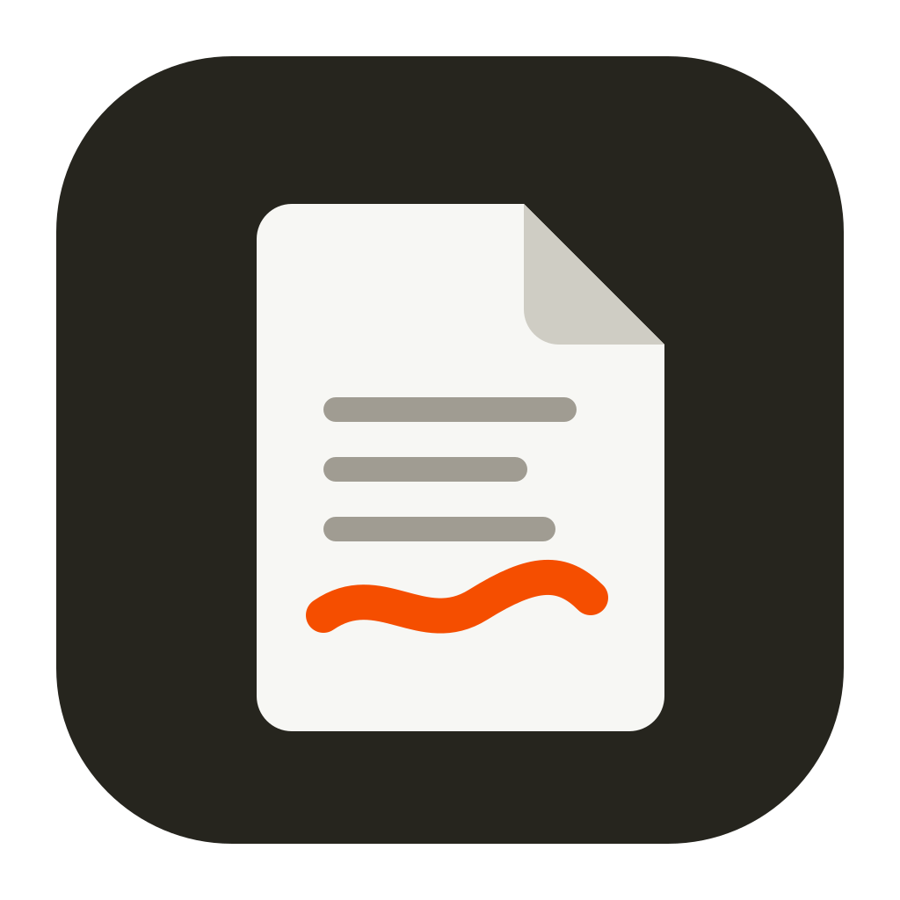

<p align="center">
  
</p>

<h1 align="center">PDF Studio</h1>

<p align="center">
  A free, offline PDF editor for Windows. Your files never leave your computer.
</p>

<p align="center">
  <b>Status: pre-alpha</b> — usable for experiments, not yet for important documents.
</p>

---

## Why

Editing a PDF usually means paying for Acrobat or uploading a private document to a website you don't trust. PDF Studio is a small desktop app that does the common jobs locally: reorder and rotate pages, merge files, annotate, fill forms, redact properly, compress.

## Features

|                                                       | Status            |
| ----------------------------------------------------- | ----------------- |
| Open and view PDFs (virtualised, smooth on big files) | in progress       |
| Page thumbnails, rotate, delete, reorder              | in progress       |
| Undo / redo for every change                          | in progress       |
| Safe saving (never corrupts the original)             | in progress       |
| Highlight, draw, shapes, text boxes, images           | planned (Phase 1) |
| Forms, signatures, true redaction, compression        | planned (Phase 2) |
| OCR, editing existing text                            | planned (Phase 3) |

See [`docs/ARCHITECTURE.md`](docs/ARCHITECTURE.md) for how it's built and the [roadmap](docs/ARCHITECTURE.md#16-roadmap-revised).

## Tech

[Tauri 2](https://tauri.app) · React 19 + TypeScript · [MuPDF.js](https://mupdf.readthedocs.io) (WebAssembly) in a Web Worker · Zustand · Vite.

## Getting started

Requirements: Node.js 22.12+, Rust (stable), and on Windows the [Tauri prerequisites](https://tauri.app/start/prerequisites/) (Microsoft C++ Build Tools and WebView2).

```bash
npm install
npm run app:dev     # run the desktop app with hot reload
npm run app:build   # build the Windows installer (.exe) into src-tauri/target/release/bundle/nsis
```

Full setup, scripts and troubleshooting: [`docs/DEVELOPMENT.md`](docs/DEVELOPMENT.md).

## Versioning

Every commit bumps the patch version while the app is in pre-alpha (`1.0.0-pre-alpha`, `1.0.1-pre-alpha`, …). Details: [`docs/VERSIONING.md`](docs/VERSIONING.md). Changes are listed in [`CHANGELOG.md`](CHANGELOG.md).

## Licence

[AGPL-3.0-or-later](LICENSE). PDF Studio uses MuPDF, which is AGPL-licensed, so the app is too. You can use it, change it and share it; if you share a modified version, share its source as well.
