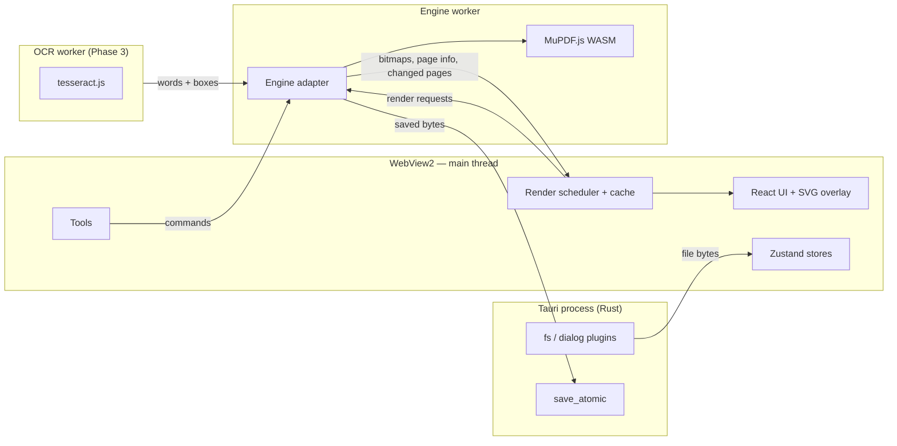

# PDF Studio — Architecture

> Status: **accepted, in implementation** (written 12 Nov 2026; updated for 1.0.9-pre-alpha). Every decision below lists the options considered, what was chosen, and why. Anything marked **🔬 Spike** must be proven with a small throwaway prototype before we build on it.
>
> **What building it taught us.** These amendments are already in the code. Each has an ADR in [`decisions/`](decisions/README.md).
>
> 1. **Three coordinate spaces, not two.** MuPDF already gives page geometry in a top-left, y-down space with rotation applied ("page space"). Raw PDF user space only appears when touching PDF objects. See `src/lib/coords.ts`.
> 2. **Save by replay** ([ADR 0004](decisions/0004-save-by-replay.md)). Spike 3 found that MuPDF's journal can't undo past a save of the live document. The live document is never saved; saving replays the command history onto a fresh copy of the original file.
> 3. **Saving is two steps:** produce the bytes, then mark the document clean only after the write succeeds. A cancelled dialog or failed write never hides unsaved changes.
> 4. **The engine worker announces when it's ready.** MuPDF loads its WASM with a top-level `await`, and messages sent to a worker before it listens are dropped. The client waits for a ready message before calling it.
> 5. **Thumbnails aren't virtualised yet**, only lazily rendered (IntersectionObserver), because dnd-kit sorting and virtualisation don't mix easily. Revisit for 1,000+ page files.

---

## 0. Decisions at a glance

| #   | Decision       | Choice                                                                                                        | Main alternative                            | Why, in one line                                                                                                             |
| --- | -------------- | ------------------------------------------------------------------------------------------------------------- | ------------------------------------------- | ---------------------------------------------------------------------------------------------------------------------------- |
| 1   | App shell      | **Tauri 2**                                                                                                   | Electron                                    | 10–20 MB app instead of 100 MB+, real security model, Rust only as thin glue                                                 |
| 2   | PDF engine     | **MuPDF.js (WASM)** — one engine for everything                                                               | pdf.js + pdf-lib                            | One parser renders _and_ edits; has true redaction, text geometry, undo journal. AGPL doesn't matter since we're not selling |
| 3   | Threading      | **Engine in a Web Worker**, talked to via Comlink                                                             | Engine on main thread                       | Rendering a heavy page must never freeze the UI                                                                              |
| 4   | Edit model     | **Live document + MuPDF journal** for undo/redo; user additions are **real PDF annotations**                  | Op list replayed on save (my earlier brief) | What you see _is_ the PDF; edits stay editable in Acrobat/Edge/Chrome too                                                    |
| 5   | Edit overlay   | **SVG overlay** for handles, selection, drawing                                                               | Konva canvas                                | The engine draws the final look; the overlay only draws temporary UI, so a scene-graph library is overkill                   |
| 6   | UI             | **React + TypeScript + Vite**, Zustand, Radix primitives, dnd-kit, TanStack Virtual                           | Svelte, Redux                               | You already know React; these libraries are small and do one job each                                                        |
| 7   | Saving         | **Atomic full save** by default (temp file → rename), incremental save as an option, crash-recovery snapshots | Overwrite in place                          | A crash mid-write must never destroy the original                                                                            |
| 8   | Fonts          | **Bundled Noto fonts** (Latin, Devanagari, ₹) embedded as subsets                                             | PDF built-in fonts only                     | Built-in fonts can't even type ₹                                                                                             |
| 9   | OCR (Phase 3)  | **tesseract.js in its own worker**, language data bundled                                                     | Python sidecar                              | Keeps the whole app one language, fully offline                                                                              |
| 10  | Python sidecar | **Dropped**                                                                                                   | PyMuPDF via PyInstaller                     | MuPDF.js covers what we needed Python for                                                                                    |

Two of these change the brief I wrote earlier (engine, and the edit model). Section 4 and 6 explain why.

---

## 1. A short PDF primer (you need this to understand every decision below)

A PDF is not a document format in the Word sense. It's closer to a **frozen print job**.

- **Objects.** A PDF file is a bag of numbered objects (dictionaries, arrays, numbers, strings, binary _streams_). A cross-reference table (**xref**) at the end of the file says where each object starts, so readers can jump straight to it.
- **Pages.** Each page object points to a **content stream** (a little drawing program) and **resources** (the fonts, images and colour spaces that program uses).
- **Content streams** are instructions like: _set font F1 at 12pt, move to (72, 700), draw glyphs "Hello"_. There are no paragraphs, no lines, no reflow — only "this glyph goes at this coordinate". That's why "edit existing text" is hard: there is no text box to edit, just positioned glyphs.
- **Fonts** are usually **subset-embedded**: only the glyphs actually used are stored. If the page says "Invoice" and you want to type "Z", the embedded font may simply not contain a Z.
- **Coordinates.** Units are **points** (1/72 inch). Origin is **bottom-left**, y goes **up**. Screens are top-left, y goes down. Pages can also have a `/Rotate` and a cropbox offset. Every bug you'll ever have with "the box landed in the wrong place" lives here.
- **Annotations** are objects that sit _on top of_ the page content, separate from it: highlights, ink, notes, free text, stamps, links, and form fields (_widgets_). Each annotation carries an **appearance stream** — its own mini content stream describing how it looks — so any viewer can draw it identically. Annotations stay movable and deletable. **Flattening** an annotation means merging its appearance into the page content so it becomes permanent.
- **Forms** (AcroForm) are widget annotations plus field values. (There's also XFA, an old Adobe XML form format — mostly dead, we will not support it.)
- **Incremental updates.** A PDF can be changed by _appending_ new versions of objects plus a new xref to the end of the file, leaving the original bytes untouched. Digital signatures depend on this. The alternative is a **full rewrite**, which produces a clean, often smaller file.
- **Redaction** done properly means _removing_ the text/image data under a region, not drawing a black box over it. A black rectangle over text leaves the text copy-pasteable — a classic real-world leak.
- **Encryption.** PDFs can be password-protected (open password) or permission-restricted (owner password: "no printing", etc.).

Keep this model in mind: **render** = run content streams + annotation appearances into pixels. **Edit** = add/change objects, mostly annotations. **Hard edit** = rewrite content streams.

---

## 2. What "good" means for this app

These are the constraints every decision is measured against:

1. **Private and offline.** No network access at all. Files never leave the machine.
2. **Faithful.** What you see on screen must be exactly what gets saved, and the saved file must look the same in Acrobat, Edge and Chrome.
3. **Non-destructive.** Never corrupt or silently overwrite the original. Undo should cover everything.
4. **Fast enough.** Opens a 300-page PDF quickly; scrolling stays smooth; the UI never freezes.
5. **Small and simple to install.** A single Windows installer.
6. **A good learning project.** Prefer designs where you understand every moving part over designs that hide everything behind one giant library. Keep the codebase in one main language (TypeScript) with a small, well-understood amount of Rust.
7. **Not for sale.** This removes licence pressure, which matters a lot in decision 2.

---

## 3. Decision 1 — The app shell (how a web UI becomes a .exe)

### Options

| Option                      | How it works                                                                                                                                                    | Installer size                 | Pros                                                                                                                                         | Cons                                                                                                                 |
| --------------------------- | --------------------------------------------------------------------------------------------------------------------------------------------------------------- | ------------------------------ | -------------------------------------------------------------------------------------------------------------------------------------------- | -------------------------------------------------------------------------------------------------------------------- |
| **Tauri 2** ✅              | Your React app runs in the OS's built-in webview (on Windows: **WebView2**, which is Chromium/Edge). A small Rust process owns the window, files and OS access. | ~10–20 MB with our WASM engine | Tiny; fast startup; low RAM; explicit permission system ("capabilities"); first-class installers (NSIS/MSI), file associations, auto-updater | Some Rust; webview differs per OS (irrelevant: we're Windows-only and WebView2 _is_ Chromium)                        |
| **Electron**                | Ships a whole Chromium + Node.js with your app.                                                                                                                 | ~100 MB+                       | Pure JS/TS everywhere; huge ecosystem; identical rendering everywhere                                                                        | Heavy; each app carries its own browser; Node in the app widens the attack surface unless you lock it down carefully |
| **Wails** (Go)              | Like Tauri but the backend is Go                                                                                                                                | small                          | Simple; Go is easy                                                                                                                           | Smaller ecosystem; you'd learn Go instead of Rust for little benefit                                                 |
| **Native .NET (WPF/WinUI)** | C# desktop UI                                                                                                                                                   | small                          | Truly native Windows feel                                                                                                                    | New language + UI framework; PDF engines for .NET are mostly commercial or wrappers; throws away your React skills   |
| **Qt (C++/Python)**         | Native cross-platform UI toolkit                                                                                                                                | medium                         | Very capable; PyQt + PyMuPDF is a classic combo                                                                                              | Different UI paradigm; Qt licensing nuances; you'd be learning a toolkit, not building the product                   |
| **Flutter desktop**         | Dart, own renderer                                                                                                                                              | medium                         | Nice UI                                                                                                                                      | No strong PDF editing engine in Dart; new language                                                                   |
| **Browser PWA**             | Just a website installed as an app                                                                                                                              | 0                              | Simplest                                                                                                                                     | Weaker file-system access, file associations, "Open with…" from Explorer; feels less like a real app                 |

### Recommendation: Tauri 2

- **Size and speed.** A PDF tool is something you open many times a day for 30 seconds. Startup time and RAM matter more than for most apps.
- **WebView2 is Chromium.** The usual argument for Electron ("same rendering everywhere") doesn't apply on Windows — WebView2 ships with Windows 11 and is on almost every Windows 10 machine; the Tauri installer can install it if missing.
- **The security model teaches you something.** In Tauri 2, the frontend can only call OS features you explicitly grant in `src-tauri/capabilities/*.json` (e.g. "may read files the user picked in a dialog"). That's a real-world concept (least privilege) you'll reuse.
- **Rust stays small.** Our Rust side will be well under 200 lines: an atomic-save command, maybe a recovery-file helper, and plugin setup. Everything else uses official plugins (`dialog`, `fs`, `single-instance`, later `updater`).

**When I'd switch to Electron:** if a Tauri-specific bug blocks you for more than a day, or you discover you need Node-only libraries. Because all PDF logic lives in the frontend + worker (not in Rust), the switch would mostly mean replacing ~5 small files in `src/platform/`. That's deliberate — see the "platform adapter" in §13.

---

## 4. Decision 2 — The PDF engine (the most important decision)

This decides what features are easy, what's hard, and what's impossible.

### Options

| Option                                            | Licence            | Render                          | Page ops                              | Annotations                                                       | Forms    | True redaction                    | Edit existing text                 | Notes                                                                                                                                                                                                                                               |
| ------------------------------------------------- | ------------------ | ------------------------------- | ------------------------------------- | ----------------------------------------------------------------- | -------- | --------------------------------- | ---------------------------------- | --------------------------------------------------------------------------------------------------------------------------------------------------------------------------------------------------------------------------------------------------- |
| **pdf.js + pdf-lib** (my earlier brief)           | Apache-2.0 / MIT   | ✅ excellent (Firefox's engine) | via pdf-lib ✅                        | pdf.js has an editor for basic ones; pdf-lib writes low-level     | ✅ basic | ❌                                | ❌                                 | **Two separate parsers** for the same file. pdf-lib's last release was 1.17.1 in 2021 and it's effectively unmaintained (a maintained fork exists: `@cantoo/pdf-lib`). No compression, no OCR text layer, no font-aware text extraction for editing |
| **MuPDF.js** (WASM build of MuPDF, by Artifex) ✅ | AGPL-3.0 (or paid) | ✅ excellent                    | ✅ insert/delete/rotate/graft (merge) | ✅ full set: highlight, ink, free text, shapes, stamps, redaction | ✅       | ✅ removes text/images/vector art | primitives ✅ (redact + re-insert) | **One engine** for everything; same core as PyMuPDF; has an **undo journal** that works in WASM; precise text geometry (`StructuredText`) for selection, search and highlights; save with garbage collection + compression                          |
| **PDFium** via `pdfium-render` (Rust)             | BSD/Apache         | ✅ (Chrome's engine)            | ✅                                    | ✅                                                                | ✅       | partial                           | page objects editable              | Excellent, permissive — but all logic would live in **Rust**, which breaks "keep Rust minimal"                                                                                                                                                      |
| **PyMuPDF sidecar** (Python process)              | AGPL               | ✅                              | ✅                                    | ✅                                                                | ✅       | ✅                                | best-documented                    | Same engine as MuPDF.js but via a separate process: +50–80 MB bundle, slow startup, IPC for every render, two languages                                                                                                                             |
| **Commercial SDKs** (Apryse, Nutrient/PSPDFKit)   | Paid               | ✅✅                            | ✅                                    | ✅                                                                | ✅       | ✅                                | ✅                                 | Defeats the point of the project                                                                                                                                                                                                                    |

### Recommendation: MuPDF.js as the single engine

**Why this changes my earlier brief.** I originally recommended pdf.js + pdf-lib _because they're permissively licensed_, and only reached for MuPDF (via a Python sidecar) for the hard features. You've now said you'll never sell this. That removes the only real argument against MuPDF, and MuPDF wins on almost every technical axis:

1. **One parser, one truth.** With pdf.js + pdf-lib, pdf.js reads the file to display it and pdf-lib reads it again to modify it. They can disagree on malformed files (very common in the wild), and after every edit you'd have to re-serialise with pdf-lib and re-load in pdf.js to see the result. With MuPDF, the same in-memory document is rendered, edited, re-rendered and saved.
2. **The hard features are built in.** True redaction (`applyRedactions`), text extraction with per-character position _and font_ (needed for Phase 3 text editing), search returning exact quads, compression on save, merging via `graftPage`.
3. **Undo/redo for free (almost).** MuPDF has a **journal**: wrap each user action in `beginOperation("Rotate page 3")` … `endOperation()` and the engine can `undo()`/`redo()` any change, including page operations. This is supported in the WASM build (only _saving_ the journal to disk is not).
4. **No Python sidecar.** Phase 3 no longer needs a second runtime, PyInstaller, or a 60 MB bundle. The whole app is TypeScript + a bit of Rust.
5. **Maintained.** MuPDF.js hit 1.0 in Nov 2024 and is actively developed by Artifex, the company behind Ghostscript and MuPDF.

**What AGPL actually means for you.** AGPL (like GPL) obliges you to share your source code with anyone you _distribute_ the program to. Using it yourself: no obligations. Giving the .exe to friends: that's distribution, so you must offer them the source — which is satisfied by keeping the repo public on GitHub (`ohsinnerman/pdf_studio`) under AGPL. The "network" clause of AGPL only matters for software offered as a web service; not our case. (I'm not a lawyer, but this is the standard reading.)

**Costs and risks, honestly:**

- **Bundle size.** The WASM binary is several MB (~10 MB). Fine for a desktop app; would be a concern for a website.
- **Lower-level API, fewer tutorials.** Most Stack Overflow answers are for PyMuPDF. Good news: the JS API mirrors MuPDF's core API closely, and PyMuPDF answers usually translate.
- **Some functions are "mutool only".** A few methods in MuPDF's JS docs (e.g. `setStampImage`, `saveJournal`) don't exist in the WASM build. We'll check every API we rely on in the spikes.
- **Text boxes with custom fonts are fiddly.** MuPDF's built-in FreeText appearance only supports the three standard fonts (Helvetica, Times, Courier). For Noto/Devanagari/₹ we generate the appearance ourselves (see §8). **🔬 Spike 2.**

**What I'd keep from the old plan:** nothing in the engine layer. pdf.js would still be a fine _viewer_ if MuPDF disappoints in Spike 1, and the engine adapter (§13) makes swapping possible.

---

## 5. Decision 3 — Threads: where the engine runs

### The problem

JavaScript in the webview runs your UI on **one main thread**. Rendering a dense page (a scanned A3 at 300 dpi, a CAD drawing) can take 100–1000 ms. If that runs on the main thread, the app freezes: no scrolling, no clicks, no spinner animation.

### Options

1. **Main thread** — simplest, and wrong for us.
2. **Web Worker** ✅ — a separate JS thread inside the webview. The MuPDF WASM module is loaded _inside the worker_. The UI sends requests ("render page 4 at 150%") and gets results back.
3. **Rust side** — move rendering into the Tauri process (PDFium). Fast, but we've decided against heavy Rust.
4. **Multiple workers (pool)** — render several pages in parallel. Tempting, but each worker would need its own copy of the document in memory, and edits would have to be synchronised between them. Not worth it at first.

### Recommendation: one engine worker + one OCR worker (Phase 3)

- **Comlink** (tiny library from Google Chrome Labs) turns `postMessage` into normal async function calls: `await engine.renderPage(4, 1.5)`. Without it you'd hand-write a message protocol with request IDs — a good exercise to understand, but tedious to maintain. I'd suggest reading Comlink's ~300 lines once so it isn't magic.
- **Transferables.** Rendered pixels come back as an `ImageBitmap` or `ArrayBuffer` that is _transferred_ (moved, zero-copy) rather than copied. For a 2000×2800 page that's 22 MB we don't copy every render.
- **Priority queue + cancellation.** When you scroll fast, requests for pages that have already scrolled off-screen are dropped before they start. Without this, fast scrolling queues dozens of useless renders.
- **The worker is the single owner of the document.** The UI never holds PDF objects, only plain data (page sizes, annotation lists, pixels). This keeps the boundary clean and is what makes the engine swappable.

---

## 6. Decision 4 — The document & editing model

This is the heart of the architecture: _where does the truth live, and how do edits flow?_

### Option A — Op list replayed on save (my earlier brief)

The original file is read-only. Every edit is a JSON operation (`{type:"addText", page:2, x, y, …}`) in a list. The screen shows the original render plus overlay objects drawn by the UI. On save, all ops are replayed into a fresh copy.

- ✅ Simple undo (move a pointer in the list), engine-agnostic, original untouched.
- ❌ **Two renderers.** The overlay (drawn by the browser) and the saved result (drawn by the PDF engine) are different code paths. Fonts, line widths and colours _will_ differ slightly — what you see isn't exactly what you get.
- ❌ Edits aren't "in" the PDF until save, so features that read the document (search, text selection, page thumbnails, redaction previews) don't see them.
- ❌ Save gets slower as ops grow, and replay bugs only show up at save time.

### Option B — Live document with engine journal ✅

The worker holds the open `PDFDocument`. Every user action is a **command** that modifies it immediately inside a journal operation. Affected pages are re-rendered by the engine.

- ✅ **True WYSIWYG** — the pixels on screen come from the same engine that writes the file.
- ✅ Search, thumbnails, selection all see edits instantly.
- ✅ Saving is just `saveToBuffer()` — instant and boring (boring is good).
- ✅ Undo/redo handled by MuPDF's journal, covering _everything_, including page deletes and redactions.
- ❌ Tied to MuPDF (mitigated by the engine adapter).
- ❌ The journal lives in memory; can't be persisted in WASM, so crash recovery uses periodic snapshots instead (§9).

### Recommendation: Option B, with commands as the only way to change a document

```
UI event ──► Command { label, run(doc) } ──► worker:
                                              doc.beginOperation(label)
                                              run(doc)               // add annot, rotate, …
                                              doc.endOperation()
                                         ◄── { changedPages: [3], docRevision: 42 }
UI: bump revision → invalidate renders of page 3 → re-render
```

- **Commands are plain objects with a label.** The label powers the Edit menu ("Undo Delete page 3"), and the set of commands is the complete list of things the app can do — easy to test and reason about.
- **Revisions, not diffing.** The worker increments a `docRevision` and returns which pages changed. The UI keeps a render cache keyed by `(page, zoom, pageRevision)`; a bumped revision automatically invalidates only what changed.

### Annotations vs page content — what an "edit" actually becomes

| User action                         | Stored as                                                     | Why                                                  |
| ----------------------------------- | ------------------------------------------------------------- | ---------------------------------------------------- |
| Highlight / underline / strike text | Text-markup annotation with QuadPoints                        | Standard; other viewers show and edit it             |
| Freehand drawing                    | Ink annotation                                                | Same                                                 |
| Rectangle, ellipse, line, arrow     | Square / Circle / Line annotation                             | Same                                                 |
| Sticky note                         | Text annotation                                               | Same                                                 |
| Text box                            | FreeText annotation, custom appearance for non-standard fonts | Stays movable/editable later, in our app and others  |
| Image / signature                   | Stamp annotation with image appearance                        | Movable later; flatten when finalising               |
| Whiteout                            | Square annotation, white fill                                 | Just covers; honestly labelled "cover", not "remove" |
| **Redact**                          | Redaction annotation → `applyRedactions`                      | Actually deletes the underlying text/image data      |
| Fill form                           | Widget field values                                           | That's what forms are                                |
| Rotate / delete / reorder / merge   | Page tree changes                                             | No annotations involved                              |
| Edit existing text (Phase 3)        | Redact the span + write new text into the content             | The only real way to change baked-in text            |

Plus a **"Flatten"** command (per-annotation or whole document) for when you're sending a final copy and don't want the recipient moving your signature.

**Why annotations instead of drawing straight into the page content?** Because they keep your edits _editable_: reopen the file next week and move that text box. Acrobat, Edge and Chrome will also show them correctly, since each annotation carries its own appearance stream.

### UI-only state (never goes in the PDF or journal)

Zoom, scroll position, current tool, tool settings (pen colour, font size), selection, panel layout. Undoing must never change your zoom.

---

## 7. Decision 5 — Rendering pipeline

What happens between "page 47 scrolled into view" and "you see it":

1. **Virtualised page list.** Only pages near the viewport exist in the DOM (TanStack Virtual). A 500-page document has ~5 page elements, not 500. Page _sizes_ for all pages are fetched once at open so the scrollbar is correct before anything renders.
2. **Two-pass render.** First a cheap low-resolution render (or the thumbnail, scaled up) so the page never appears blank; then the sharp render.
3. **Device pixel ratio.** On a 150%-scaled Windows laptop screen, a 100% zoom page needs 1.5× pixels or it looks blurry. Render scale = `zoom × devicePixelRatio × (72→96 conversion)`.
4. **Tiling at high zoom.** At 400% an A4 page is ~13,000 px tall — too big for one canvas (browsers cap canvas size and memory explodes). Above a threshold, render only the visible tiles of the page at full resolution. This is a Phase 1.5 improvement — start without it but design the render request as `renderRegion(page, scale, clipRect)` from day one so tiles are a change in the caller, not the engine.
5. **Caches.** An LRU cache of rendered bitmaps (by memory budget, e.g. 300 MB) and a separate thumbnail cache. Close a bitmap (`ImageBitmap.close()`) when evicted — GPU memory doesn't garbage-collect promptly.
6. **Annotations are drawn by the engine**, as part of the page render — that's what makes the screen faithful. The overlay (next section) only draws _interaction_.

---

## 8. Decision 6 — UI stack and the interaction overlay

### Framework: React + TypeScript + Vite

- **React** — you know it, and every library we need (virtualisation, drag-and-drop, accessible menus) has a mature React version. Svelte or Solid would be faster and smaller, and fun to learn, but you'd be learning two hard things at once. The PDF part is the interesting learning here.
- **TypeScript (strict mode)** — the coordinate code especially benefits from types: we'll use _branded types_ so `PdfPoint` and `ScreenPoint` can't be mixed up by accident. That one trick prevents the most common class of bugs in PDF editors.
- **Vite** — fast dev server; Tauri's official template uses it; handles WASM and module workers.

### State: Zustand

- **Why Zustand:** tiny, no boilerplate, and stores can be read/written _outside_ React components — useful because worker callbacks update state.
- **Alternatives:** Redux Toolkit (more ceremony, great devtools — overkill here); Jotai (atom-based, also good); XState (state machines — actually a nice fit for _tool interactions_, see below, but heavy for global state).
- **Stores, split by reason-to-change:** `documentStore` (open docs, page sizes, revisions, dirty flag), `viewStore` (zoom, scroll, layout), `toolStore` (active tool + settings), `selectionStore`.

### Tools as small state machines

Each tool (select, highlight, pen, text, rectangle, redact, …) is an object with `onPointerDown / Move / Up / KeyDown` handlers and a tiny internal state (`idle → dragging → committed`). Only one tool is active. This keeps tool logic out of components and makes adding a tool a single new file. We'll hand-write these rather than pull in XState — they're small, and you'll see exactly how they work.

### The interaction overlay: SVG (changed from Konva)

On top of each page bitmap sits an absolutely-positioned **SVG** in page coordinates. It draws: selection boxes and resize handles, the rubber-band rectangle while dragging, the live ink stroke while drawing, text-selection highlights, and search hits.

- **Why not Konva anymore?** In the old design, Konva _was_ the renderer for user objects, so it needed a scene graph. Now the engine renders everything permanent; the overlay only shows a handful of temporary shapes. SVG does that natively in React, stays crisp at any zoom, gets browser hit-testing and accessibility for free, and is one less library.
- **When would we need canvas?** If live ink with thousands of points gets sluggish. Then just the in-progress stroke moves to a small canvas.
- **Text boxes while typing:** a real `<textarea>` positioned over the page (so typing, IME for Hindi/Kannada, spellcheck and clipboard all just work). On blur it's committed as a command and the engine draws the final version.

### Other UI libraries

- **Radix UI primitives** (or shadcn/ui, which is built on them) for menus, dialogs, popovers, tooltips — accessible and unstyled. Building accessible dropdowns from scratch is a time sink with no PDF learning in it.
- **dnd-kit** for drag-to-reorder thumbnails (supports multi-select drag and keyboard reordering).
- **Styling:** Tailwind or CSS Modules — your call; nothing in the architecture depends on it.
- **Keyboard shortcuts** through one central registry, so the same action is reachable from menu, toolbar and shortcut.

---

## 9. Decision 7 — Files, saving and safety

### Opening

- Native **Open dialog** (`tauri-plugin-dialog`), **drag-and-drop** onto the window, **"Open with PDF Studio"** from Explorer (Tauri `fileAssociations` in the bundle config), and **single instance** (`tauri-plugin-single-instance`) so double-clicking a second PDF opens a new tab in the running app instead of a second window.
- Bytes are read via `tauri-plugin-fs` (binary IPC in Tauri 2 is efficient) and **transferred** to the worker.
- **Encrypted PDFs:** detect `needsPassword()`, prompt, `authenticatePassword()`. Owner-password restrictions ("no editing") — MuPDF can technically ignore them; we'll show a notice and let you decide, since they're your own files.
- **Broken PDFs:** MuPDF repairs many automatically (rebuilds a damaged xref). Show a "This file was repaired" notice so you know the saved file will differ.

### Saving

- **Atomic save (the only way we write files).** Write to `file.pdf.tmp` in the same folder → flush → rename over the original. A crash or power cut leaves either the old file or the new one, never half of each. This is the one custom Rust command worth writing (~30 lines), and a nice first Rust exercise.
- **Full rewrite by default** (`garbage=…,compress=yes`): removes deleted objects and compresses streams — files usually get smaller.
- **Incremental save as an option** (`incremental`): appends changes, preserves existing digital signatures, faster on huge files. Used automatically if the document is signed.
- **"Save As" / "Export flattened copy" / "Export page range"** are separate commands.
- **Dirty tracking:** the window title shows `•` when unsaved; closing prompts.

### Crash recovery

The journal can't be written to disk in WASM, so every N minutes (when dirty) the worker calls `saveToBuffer()` and we write it to `%APPDATA%\PDF Studio\recovery\`. On next launch, if recovery files exist, offer to restore. Deleted on clean save/close.

### OneDrive note

Your project folder is under OneDrive. That's fine for source code, but for test PDFs prefer a non-synced folder: OneDrive can briefly lock files while syncing, which can make the rename step of an atomic save fail. The save command will retry a few times and then report the error clearly instead of failing silently.

---

## 10. Decision 8 — Fonts and text

- **The 14 standard PDF fonts** (Helvetica, Times, Courier…) need no embedding but only cover Western European characters. **They can't type ₹**, let alone Hindi or Kannada.
- **Plan:** bundle a small set of open-licensed fonts (OFL): **Noto Sans / Noto Serif** (Latin, including ₹), **Noto Sans Devanagari** (Hindi/Marathi), optionally **Noto Sans Kannada**, and a monospace font. Embedded as **subsets** (`addFont` creates an Identity-H CID font), so a text box adds kilobytes, not megabytes.
- **Complex scripts need shaping.** Devanagari letters change form and combine (conjuncts, matras). Correct output needs a _shaping engine_ (HarfBuzz). MuPDF includes HarfBuzz for its own layout features; whether we can drive it from JS for annotation appearances is part of **🔬 Spike 2**. Fallback for Phase 1: Latin + ₹ only, with Indic text boxes deferred.
- **System fonts:** letting you pick any installed Windows font is a nice later feature (read the font file via Rust, hand bytes to the engine).

---

## 11. Decision 9 — Security and privacy

PDFs are a classic malware delivery format, and a PDF editor is a parser of untrusted input.

- **No JavaScript in PDFs, ever.** PDFs can contain scripts (form calculations, "open URL on load"). We never enable MuPDF's JS engine. Form calculations simply won't auto-run — acceptable.
- **No launch actions.** Links that try to run programs or open files are ignored; web links ask before opening in your browser.
- **Offline by construction.** The webview's Content Security Policy sets `connect-src 'self'` (no outbound requests), and no network-capable Tauri plugin is enabled. If you later add the auto-updater, that's one deliberate exception.
- **Least privilege.** Tauri capabilities allow file access only to paths the user picked (plus our app-data folder for recovery). The frontend can't read arbitrary files even if a bug tried to.
- **Parser isolation.** MuPDF runs inside WASM — a memory-safe sandbox. A malicious PDF exploiting a C bug in the parser can at worst crash the worker, which we detect and restart (recovery snapshot preserves your work).
- **Redaction honesty.** "Cover" (whiteout) and "Redact" are separate tools with different icons and wording, and redaction shows a confirmation explaining it's permanent. After redaction we also offer to strip metadata (author, original title, XMP).

---

## 12. Decision 10 — Phase 3: OCR and editing existing text

### OCR

- **tesseract.js** (Apache-2.0) — Tesseract compiled to WASM, in its **own worker** (OCR takes seconds per page and must not block the engine worker).
- **Language data bundled with the app** (`eng`, `hin`, optionally `kan`). By default tesseract.js downloads language files from a CDN — we must disable that to stay offline.
- **Output:** words + bounding boxes → the engine writes an **invisible text layer** (text render mode 3) behind the scanned image. The page looks unchanged, but text becomes selectable and searchable. This is exactly what "searchable PDF" means.
- **Alternative considered:** OCRmyPDF (Python + Tesseract + Ghostscript) gives better results but needs the sidecar we've just removed. Revisit only if tesseract.js quality disappoints.

### Edit existing text

1. Get the page's `StructuredText`: blocks → lines → characters, each with font name, size, colour and exact quad.
2. You click a line; we show a `<textarea>` prefilled with that line's text, styled to match.
3. On commit: redaction annotation over the line's quads → `applyRedactions` (removing only text, keeping images/line art) → write the new text at the same baseline origin.
4. **Font choice:** if the embedded font contains every glyph you typed, reuse it; otherwise fall back to the closest bundled font (serif/sans/mono by name heuristics) and show a small "font substituted" marker.
5. **Known limits we accept:** no reflow (a longer line doesn't push the next line down); justified text loses justification; kerning may differ slightly. That's the same trade-off most non-Adobe editors make.

---

## 13. Code organisation

### Layers (dependencies only point downward)

```
┌───────────────────────────────────────────────────────────┐
│ UI (React components)        src/components, src/features │  knows: stores, commands, tools
├───────────────────────────────────────────────────────────┤
│ App logic                    src/state, src/commands,     │  knows: engine *interface*,
│                              src/tools, src/render         │         platform *interface*
├──────────────────────────────┬────────────────────────────┤
│ Engine adapter               │ Platform adapter            │
│ src/engine (runs in worker)  │ src/platform (Tauri calls)  │
├──────────────────────────────┼────────────────────────────┤
│ MuPDF.js (WASM)              │ Tauri plugins + tiny Rust   │
└──────────────────────────────┴────────────────────────────┘
```

- **Engine adapter** (`src/engine/`): the _only_ code that imports `mupdf`. Exposes our own interface (`openDocument`, `renderRegion`, `getPageInfo`, `getAnnotations`, `runCommand`, `undo`, `redo`, `save`, `search`, `getTextAt`). If MuPDF disappoints, we replace this folder, not the app.
- **Platform adapter** (`src/platform/`): the _only_ code that imports `@tauri-apps/*`. Exposes `openFileDialog`, `readFile`, `saveAtomic`, `onFileOpened`. Swapping to Electron = rewriting this folder.
- **Coordinates** (`src/lib/coords.ts`): the only place that converts between PDF space and screen space, handling zoom, DPR, page rotation and cropbox offset. Fully unit-tested.

### Folder structure

```
pdf_studio/
├── docs/
│   ├── ARCHITECTURE.md        ← this file
│   └── decisions/             ← short ADRs when we change a decision later
├── src/
│   ├── main.tsx, App.tsx
│   ├── components/            ← generic UI: Toolbar, Sidebar, Dialogs, Tabs
│   ├── features/
│   │   ├── viewer/            ← PageList (virtualised), PageView, Overlay (SVG)
│   │   ├── thumbnails/        ← thumbnail grid, reorder via dnd-kit
│   │   ├── annotate/          ← properties panel for annotations
│   │   ├── forms/             ← form field UI (Phase 2)
│   │   └── search/
│   ├── tools/                 ← select.ts, highlight.ts, pen.ts, text.ts, rect.ts, redact.ts …
│   ├── commands/              ← one file per command group: pages.ts, annotations.ts, redaction.ts
│   ├── state/                 ← Zustand stores
│   ├── render/                ← render scheduler, priority queue, LRU bitmap cache
│   ├── engine/
│   │   ├── worker.ts          ← worker entry; exposes the API via Comlink
│   │   ├── api.ts             ← the TypeScript interface the UI depends on
│   │   └── mupdf/             ← MuPDF-specific implementation
│   ├── platform/
│   │   ├── api.ts
│   │   └── tauri.ts
│   ├── lib/                   ← coords.ts, units.ts, colors.ts, ids.ts
│   └── assets/fonts/          ← bundled Noto fonts
├── src-tauri/
│   ├── src/main.rs, lib.rs    ← plugin setup + save_atomic command
│   ├── capabilities/          ← permission files
│   └── tauri.conf.json        ← window, CSP, bundle, file associations
├── spikes/                    ← throwaway prototypes (git-ignored or kept for reference)
├── tests/
│   ├── fixtures/              ← sample PDFs (see §14)
│   └── …
└── package.json
```

### Data flow diagram



---

## 14. Testing strategy

- **Unit tests (Vitest):** `coords.ts` (every rotation × cropbox case), tools' state machines, render scheduler, commands.
- **Engine tests (Vitest, Node):** MuPDF.js also runs in Node, so commands can be tested headlessly: open fixture → run command → save → reopen → assert (page count, annotation present, redacted text really gone from `StructuredText`).
- **Visual regression:** render fixture pages to PNG and compare with stored "golden" images (pixelmatch). Catches rendering/appearance regressions.
- **Fixture corpus** (`tests/fixtures/`), collected deliberately: text-heavy doc, scanned doc, AcroForm form, password-protected file, rotated pages, mixed page sizes, 500+ page file, a deliberately broken file, a digitally signed file, a Hindi document.
- **External validation:** run saved files through `qpdf --check` and open them in Edge/Chrome/Acrobat Reader during manual testing.
- **Manual smoke checklist** per release (open → annotate → undo → save → reopen elsewhere).

---

## 15. Packaging and distribution

- **NSIS installer** (Tauri default for Windows): per-user install, no admin needed, Start-menu entry, file association for `.pdf` (optional, asked at install).
- **WebView2:** use the "download bootstrapper" mode — tiny installer, fetches WebView2 only on the rare machine without it. (Or "embed bootstrapper" for fully offline installs on friends' PCs.)
- **Code signing:** skipped. Unsigned apps trigger a Windows SmartScreen "Unknown publisher" warning; acceptable for personal use. Certificates cost money yearly.
- **Updates:** manual at first (GitHub Releases). Optional later: `tauri-plugin-updater` against GitHub Releases — the one place the app would touch the network, and only when you click "Check for updates".
- **CI (optional, later):** GitHub Actions on `windows-latest` builds the installer on each tag.

---

## 16. Roadmap (revised)

### Phase 0 — Foundations and spikes (do these before any real feature)

**Progress (1.0.9-pre-alpha):** ✅ scaffold · ✅ Spike 3 (done, and it found the save problem behind ADR 0004) · 🟡 Spike 1: the engine worker and WASM run under the production CSP in Chromium (WebView2's engine), and the release binary starts on Linux; the first run inside WebView2 on Windows is the CI installer on your PC · ⬜ Spike 2.

- **🔬 Spike 1 — Engine in a worker inside Tauri.** Load MuPDF.js in a module worker in a Tauri build (not just `vite dev`), open a 300-page PDF, render page 1, measure open time / render time / memory. _Proves the core bet._
- **🔬 Spike 2 — Custom-font FreeText.** Create a FreeText annotation whose appearance uses an embedded Noto font with "₹ 1,250" and a Hindi word; check it in Edge, Chrome and Acrobat Reader. _Decides how text boxes work._
- **🔬 Spike 3 — Journal.** Add an annotation, delete a page, undo both, redo both, save, reopen. _Proves undo design._
- Project scaffold: Tauri 2 + React + TS + Vite, lint/format, Vitest, the layer folders, `coords.ts` with tests.

### Phase 1 — Viewer + core editing (MVP)

**Done in 1.0.5–1.0.7:** open (dialog / drag-drop), virtualised scrolling, zoom, thumbnails, rotate / delete / reorder / insert blank / merge, undo/redo, atomic save, save as, dirty tracking. **Still to do:** Explorer "Open with", tabs, text selection and search, extract pages, all annotations, crash recovery.

Open (dialog / drag-drop / Explorer), tabs for multiple docs, virtualised scrolling, zoom, thumbnails, text selection & copy, search · Page ops: rotate, delete, reorder, insert blank, merge another PDF, extract pages · Annotations: highlight/underline/strike, ink, rectangle/ellipse/line/arrow, sticky note, text box, image · Select/move/resize/delete annotations · Undo/redo · Atomic save, save as, dirty tracking, crash recovery.

### Phase 2 — Forms, signatures, redaction, conversion

Fill AcroForm fields · Signatures (draw / type / image, saved locally for reuse) · Whiteout vs true redaction · Flatten · Compress (image downsampling + garbage collection) · Images → PDF, PDF → PNG/JPG · Metadata editor and "strip metadata".

### Phase 3 — Hard mode

OCR with invisible text layer · Edit existing text · Tiled rendering at high zoom · Page labels/bookmarks editing · Optional: system fonts.

---

## 17. Risks and open questions

| Risk                                                       | Impact                                | Mitigation                                                                             |
| ---------------------------------------------------------- | ------------------------------------- | -------------------------------------------------------------------------------------- |
| MuPDF.js API gaps in WASM (methods that are "mutool only") | Some features need workarounds        | Spikes first; engine adapter isolates fixes                                            |
| Custom-font text box appearances (esp. Devanagari shaping) | Text boxes limited to Latin initially | Spike 2; fallback plan in §10                                                          |
| Large documents and memory in the webview                  | Slow/crashy on huge scans             | Virtualisation, LRU budget, `ImageBitmap.close()`, tiling in Phase 3                   |
| OneDrive file locks during save                            | Save fails                            | Retry + clear error; test PDFs outside OneDrive                                        |
| Scope creep                                                | Never finishes                        | Phase gates: a phase isn't done until it works end-to-end and is used daily for a week |

**Your decisions still open** (none block Phase 0):

1. Tauri vs Electron — I recommend Tauri; say if you'd rather avoid Rust entirely.
2. Styling: Tailwind vs CSS Modules.
3. Final app name.
4. Kannada OCR/fonts in Phase 3 — yes/no.

---

## Glossary

- **AGPL** — strong copyleft licence; share source with people you distribute the program to.
- **Appearance stream** — the drawing instructions stored inside an annotation that define how it looks.
- **Comlink** — library that turns worker messaging into async function calls.
- **Content stream** — the drawing program for a page.
- **DPR** — devicePixelRatio; screen pixels per CSS pixel.
- **Flatten** — merge annotations into page content permanently.
- **Journal** — MuPDF's record of document changes used for undo/redo.
- **QuadPoints** — four-corner boxes marking text for highlights/redactions.
- **StructuredText** — MuPDF's extracted text with blocks, lines, characters and positions.
- **WebView2** — Microsoft's Chromium-based webview that Tauri uses on Windows.
- **WASM** — WebAssembly; compiled C/C++/Rust code running safely in the browser engine.
